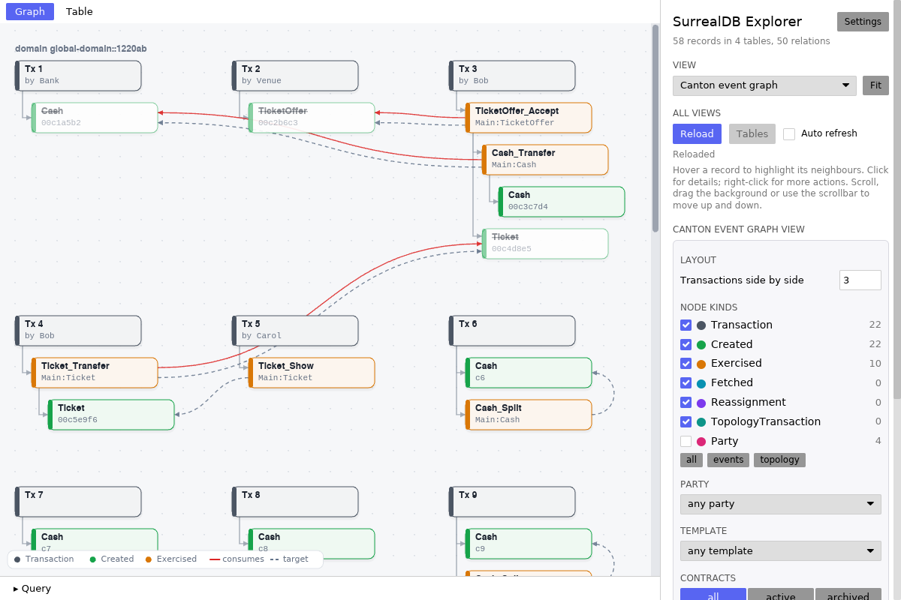

# SurrealDB Explorer

A desktop app for exploring a [SurrealDB](https://surrealdb.com) database as an
interactive graph. It's written in Rust with [iced](https://iced.rs).

It also has a dedicated view for **Canton ledger event graphs**, and a built-in
**MCP server** that lets Claude Code (or any MCP client) query the database and
draw in the app's window.

**For Canton, the explorer is meant to run in tandem with
[canton-event-graph-syncer](https://github.com/gyorgybalazsi/canton-event-graph-syncer).**
The syncer streams a ledger's events from the Ledger API into a SurrealDB
server; the explorer connects to the same server as another client and draws
the event graph, redrawing as new transactions arrive. The explorer never
talks to the ledger itself. See
[Canton: with the syncer](#canton-with-the-syncer). To see the whole chain
run with one command, try
[canton-event-graph-demo](https://github.com/gyorgybalazsi/canton-event-graph-demo).

```
Canton ledger ──▶ syncer ──▶ SurrealDB server ──▶ explorer (graph, Canton view)
                                   │
                                   └──▶ canton-analytics ──▶ Delta tables ──▶ explorer (Dashboard)
```



## Features

- **Graph view.** Records are nodes and relations are edges, in a force-directed
  layout. You can hover, select, hide, focus on a record and see its
  neighbourhood. Large databases open on a table overview first.
- **Record menu.** Right-click a record to focus or hide it, show it in the
  table, or copy its id or JSON. In the Canton view it also shows an event's
  transaction, a contract's archiving event or its whole lifecycle (create,
  exercises, fetches and archive), and filters to the record's template or
  one of its parties.
- **Pictures of the graph.** Right-click the canvas background to copy the
  whole graph as an image (⌘⇧C, or Ctrl+Shift+C) or save it as a PNG in
  Downloads.
- **Table view and query panel.** Run SurrealQL and see each query's result as
  its own graph or as rows, and copy the result as JSON or as a
  tab-separated table. The query panel only reads: see
  [Read-only queries](#read-only-queries).
- **Canton event graph view.** This view is for a SurrealDB copy of a Canton
  ledger: one column per transaction, with the event tree indented under it. It
  draws `consumes` and `target` arrows, fades archived contracts, and can show
  parties in their own column. You can filter by node kind, party (each party's
  projection), template, active or archived, offset range and text search. The
  view can page through the latest *n* transactions and follow new ones as they
  arrive. It is built to read the tables that
  [canton-event-graph-syncer](https://github.com/gyorgybalazsi/canton-event-graph-syncer)
  writes.
- **Connects to a SurrealDB server** (`ws://…`) as a root, namespace or
  database user, as one client among others (for example next to the
  syncer, which keeps writing).
- **Auto refresh.** The graph redraws when another program changes the database.
- **MCP server for Claude Code.** It lets Claude describe the schema, run
  queries, draw results in the window, and read, set or scroll to the current
  selection. Queries that would change data run only after you click Allow in
  the window; the others run as the read-only viewer user, if one is set.
- **Analytics dashboard** (optional, see [Dashboard](#dashboard)). Charts
  and tables over the Delta Lake tables that the syncer repository's
  canton-analytics daemon writes, queried with DataFusion, one dashboard per
  plugin.
- **Memory watch.** The app warns when its memory grows fast or gets large,
  and stops before the computer runs out (see `[memory]` below).
- **Sample data.** Settings → Data → *Load sample data* or *Load Canton sample*.
  There is a larger Canton demo in [`demo/canton_demo.surql`](demo/canton_demo.surql).

## Build and run

You need a recent stable Rust toolchain (edition 2024) and a running SurrealDB
server. To try the app, [install SurrealDB](https://surrealdb.com/install) and
start an in-memory server:

```sh
surreal db start --user root --pass secret memory
```

Then build and run the app:

```sh
cargo run --release
```

The first run creates `config.toml` in the current folder and connects to
`ws://127.0.0.1:8000` as `root`. Set the password (`secret` above) in
**Settings** (Settings → Data has the sample data). Every setting can be
changed there or in the file. Logs go to the terminal and to `logs/`.

To build a macOS `.app` with the icon, use
[cargo-bundle](https://github.com/burtonageo/cargo-bundle):

```sh
cargo bundle --release
```

## Canton: with the syncer

The Canton view has no ledger connection of its own. It reads a SurrealDB copy
of the ledger, and
[canton-event-graph-syncer](https://github.com/gyorgybalazsi/canton-event-graph-syncer)
is the program that makes and keeps that copy. Run the two side by side:

1. Start a SurrealDB 4 server and set up the syncer's namespace, database and
   user, as in the
   [syncer README](https://github.com/gyorgybalazsi/canton-event-graph-syncer/blob/main/syncer/README.md#surrealdb)
   (by default namespace `canton`, database `event_graph`).
2. Start the syncer (`syncer sync`). It loads the active contracts, then
   follows the ledger's updates and writes each transaction as it comes.
3. Point the explorer at the same server, namespace and database in
   **Settings** (or `[database]` in `config.toml`), and choose the Canton
   visualization (`visualization = "canton"` under `[graph]`). A
   database-level user is enough; a `VIEWER` user for the
   [read-only queries](#read-only-queries) is a good idea, since the syncer
   is the only program that should write.
4. Leave auto refresh on: new transactions appear as the syncer writes them,
   and the view can follow the newest ones.

The syncer repository also has the canton-analytics daemon, which turns the
same SurrealDB data into Delta Lake tables for the [Dashboard](#dashboard).

[canton-event-graph-demo](https://github.com/gyorgybalazsi/canton-event-graph-demo)
does all of this with one command (`just demo`): it starts a Canton sandbox,
SurrealDB, the syncer and the explorer, then buys tickets on the ledger so you
can watch the transactions arrive. Its analytics demos use the Dashboard.

## Configuration

`config.toml` has these sections:

| Section      | What it sets |
|--------------|--------------|
| `[database]` | `server`, `username`, `user_level` (`root`, `namespace` or `database`), `password`, `namespace`, `database`, and the read-only `viewer_username`, `viewer_user_level`, `viewer_password` |
| `[graph]`    | Record limits, auto refresh, the visualization (`standard` or `canton`) and Canton view options |
| `[logging]`  | Log level and folder |
| `[mcp]`      | `enabled` and `port` (default 8765) |
| `[analytics]` | The Dashboard: `location` of the tables, `storage_options`, the `selected` table and `check_seconds` (2), how often it looks for a new commit. The Dashboard's Settings button edits it, and the daemon's lag settings, which it saves next to the tables |
| `[memory]`   | The memory watch, in MB of resident memory (0 switches a check off): `warn_above_mb` (default 2048) and `growth_warn_mb` (1024 within a minute) log a warning and show it in the window; `stop_above_mb` stops the app before the computer runs out of memory (default: half the computer's memory, up to 8192; 0 never stops); `check_seconds` (5). On macOS the size is the physical footprint, as Activity Monitor shows it |

`password` and `viewer_password` can be a 1Password reference (`op://vault/item/field`). The app then
reads it with the 1Password CLI (`op`), so the secret never has to be in the
file. `config.toml` and `logs/` are in `.gitignore`.

## Dashboard

The [canton-analytics daemon](https://github.com/gyorgybalazsi/canton-event-graph-syncer/tree/main/analytics)
runs WebAssembly analytics plugins over the syncer's SurrealDB and writes
Delta Lake tables. The Dashboard reads them with DataFusion (through the
syncer repository's `canton-analytics-reader` crate). It never writes table
data, only the daemon's lag settings, which it saves next to the tables. The
daemon doesn't need the explorer to be open.

It is an opt-in feature, because it pulls in DataFusion:

```sh
cargo run --release --features dashboard            # tables in a local folder
cargo run --release --features dashboard-s3         # …or in S3 (also -azure, -gcs)
```

Click **Dashboard** next to Settings. Type where the tables are (the
daemon's `--tables`: a folder, or `s3://`, `az://` or `gs://`) and press
Enter, then pick a table. Each table shows its plugin's panels: number
cards, time series, bar charts and sortable tables, with each panel's query
time. A plugin whose panels group by period gets a **Day / Week** switch. A table without panels
gets some made from its columns. A line under the header shows the daemon's
heartbeat: up to date, catching up, stopped, not heard from, or failing.
The dashboard checks for new commits every two seconds while it is open;
**Refresh now** looks again at once, and also finds new tables. With an empty
`database.server` the app opens on the Dashboard without a database.

The syncer's `just analytics-dashboard` recipe builds the explorer with the
dashboard and opens it on a tables folder.

Cloud credentials come from the usual environment variables
(`AWS_REGION`, `AWS_ACCESS_KEY_ID`, `AZURE_STORAGE_ACCOUNT_NAME`,
`GOOGLE_APPLICATION_CREDENTIALS`…). Other object store options go in
`config.toml`:

```toml
[analytics]
location = "s3://my-bucket/canton-analytics"
storage_options = ["aws_endpoint=http://localhost:9000", "aws_allow_http=true"]
```

## Queries

**▸ Query** under the graph opens the query panel. Type SurrealQL and press
**Run** (⌘↩). The result shows under the query: rows of fields as a table (long
Canton party ids shortened; hover a value to see it whole), paths as paths, and
anything else as JSON. Records in the result are also drawn in the graph above.
**Copy JSON** copies the whole result, and **Copy table** copies a table result
as tab-separated text that pastes into a spreadsheet.
The editor grows to fit the query, and dragging the line between the graph and
the panel resizes the panel.

### Saved queries

The panel keeps named queries in `queries.toml` in the current folder. Pick one
from **Choose a saved query…** to put it in the editor, then **Run** it. Type a name
and press **Save query** to save the editor's query (an existing name is
replaced), and **Delete** removes the picked one.

A new `queries.toml` starts with the *Ticket purchase demo query*, which lists
each ticket bought in the
[canton-event-graph-demo](https://github.com/gyorgybalazsi/canton-event-graph-demo)
ticket purchase flow with its buyer and price. It can be deleted like any other
query and doesn't come back.

### Read-only queries

The queries you type in the query panel, and the ones Claude Code sends, only
read. The app keeps them from changing data in one of two ways, depending on
whether you set a read-only viewer user.

**Without a viewer user (the default): the app checks.** Queries run as the main
user, which can write. Before sending a query, the app looks for words that
change data (`CREATE`, `UPDATE`, `DELETE`, `RELATE`, `DEFINE`, `REMOVE`, a custom
`fn::…`, …) and doesn't run a query that has one. This needs no setup, but it
reads words, not meaning: it is a best-effort guard, and it can also stop a
harmless read, for example one that compares a field to `'create'`.

**With a viewer user: the server checks.** Define a user with the `VIEWER` role
and set it under **Settings → Read-only queries** (or `viewer_username` and
`viewer_password` in `config.toml`):

```sql
DEFINE USER viewer ON DATABASE PASSWORD 'viewer-secret' ROLES VIEWER;
```

Those queries then run as that user, on a second connection, and SurrealDB
itself refuses to change anything, however the query is written. It refuses
`DEFINE` and `REMOVE` with an error, but skips `CREATE`, `UPDATE`, `DELETE` and
`RELATE` silently (they return no records), so the query panel adds a note
that nothing was changed. If the viewer can't sign in, those queries don't run
at all. They never fall back to the main user.

Either way, the main user (`username`) still draws the graph, runs Settings →
Data (*Load sample data*, *Erase database*), and runs a write Claude Code asks
for after you click Allow.

## Using it from Claude Code

While the app is running, its MCP server listens on `127.0.0.1` only:

```sh
claude mcp add --transport http --scope user surrealdb-explorer http://127.0.0.1:8765/mcp
```

The tools are `get_schema`, `query`, `show`, `get_selection`, `select_record`,
`scroll_graph` and `overview`.

## Canton schema

The Canton view reads the node tables `transaction`, `created`, `exercised` and
`party`. It also reads `fetched`, `reassignment` and `topology_transaction` when
they are present. The relation tables are `action`, `consequence`, `target`,
`consumes` and `requested`. See the top of [`src/canton.rs`](src/canton.rs)
for the fields it uses.
[canton-event-graph-syncer](https://github.com/gyorgybalazsi/canton-event-graph-syncer)
writes this shape (its
[data model](https://github.com/gyorgybalazsi/canton-event-graph-syncer/blob/main/syncer/README.md#data-model)
describes the tables); any other indexer that writes it will work too.

## Tests

```sh
cargo test
```

The integration tests start temporary in-memory SurrealDB servers, so they need
the `surreal` program (4.x), on your `PATH` or in `~/.surrealdb`. They include
UI tests written with [`iced_test`](https://docs.rs/iced_test): they boot the
app against a test database and click through the window headless.

The Dashboard is a feature, so its unit tests run separately:

```sh
cargo test --features dashboard --lib
```

GitHub Actions ([`.github/workflows/ci.yml`](.github/workflows/ci.yml)) builds
and tests every pull request, once without and once with the `dashboard`
feature, and reports clippy findings.

## License

This project is licensed under either of

- Apache License, Version 2.0 ([LICENSE-APACHE](LICENSE-APACHE))
- MIT license ([LICENSE-MIT](LICENSE-MIT))

at your option.

The `surrealdb` client crate this app uses is under its own license (Business
Source License 1.1). See [surrealdb/surrealdb](https://github.com/surrealdb/surrealdb).

Unless you explicitly state otherwise, any contribution intentionally submitted
for inclusion in this work by you, as defined in the Apache-2.0 license, shall
be dual licensed as above, without any additional terms or conditions.
